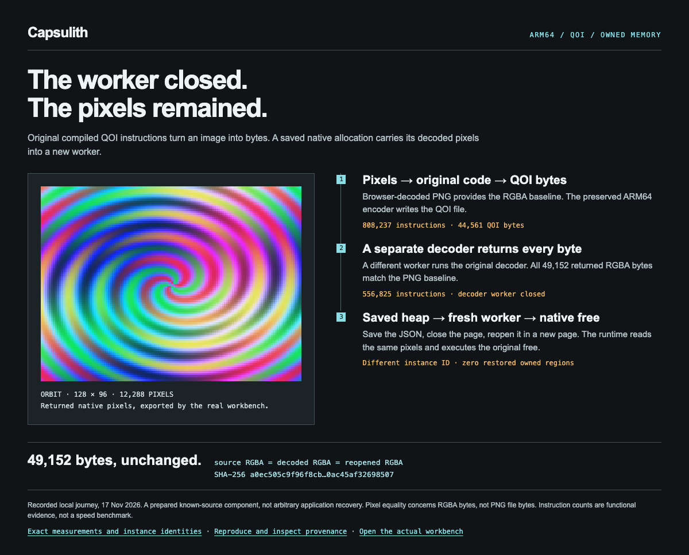

# Capsulith

**Run preserved native code. Reopen its initialized state.** Capsulith packages selected ARM64 functions, their calling contracts and owned memory for Node or the browser. Keep the original instructions and resume an initialized object in a fresh worker, without the original application.

[Open the image workbench](https://nazeeh111.github.io/Capsulith/studio/image.html) · [Reproduce this journey](docs/presentation/README.md) · [Supported artifact scope](#what-works-today)

<picture>
  <source media="(max-width: 600px)" srcset="docs/presentation/journey-mobile.png">
  
</picture>

The picture is the actual returned image. The record follows one bundled 128 × 96 PNG through **encode → separate decode → saved pixel heap → fresh-worker restore → native free**. All 49,152 RGBA bytes match across the boundary. [Exact measurements, instance identities and limits](docs/presentation/README.md) are retained with the [machine-readable execution record](docs/presentation/journey.json).

## Current development source

This checkout is **0.3.2.dev0**, an unreleased successor to the published 0.3.1
package. It retains the original native-code specimens and study records.
`capsulith --version` reports the installed Python package; the local server's
`/api/meta` reports that same version and its three workbench routes. The private
JavaScript runtime package keeps its separate 0.2.0 identity.

## Try it

[Open the native image workbench](https://nazeeh111.github.io/Capsulith/studio/image.html) and choose **Load & run example**. The prepared QOI case runs locally without an account, upload server, original binary or compiler.

For the complete source-to-state journey, open the bundled [`orbit.png`](examples/qoi/orbit.png), choose **Encode & verify pixels**, then **Save preserved JSON**. Close the page, open a new workbench and use **Reopen preserved image**. The workbench exposes the original and restored instance IDs and the native free result.

[Full workbench capture and earlier workflow evidence](docs/image-workbench-current.md).

PNG uses browser-decoded RGBA as the explicit comparison baseline; QOI-only input has no independent source-pixel comparison. Images are bounded to 256 pixels per dimension and 1 MiB. This is a known-source prepared native component demonstration, not a new codec or universal format recovery. [Original QOI source, contracts, independent native/FFmpeg controls and standalone Node commands](examples/qoi/README.md).

For PNG input, the extracted original encoder writes a QOI file and a separate native decoder returns its pixels for comparison with browser-decoded RGBA. QOI input goes directly to the original decoder. Inspect individual bytes, preserve the initialized pixel allocation, then restore and free it in a fresh worker.

Try the [keyless browser object demo](https://nazeeh111.github.io/Capsulith/) and press **Run lifecycle**. It executes the actual extracted instructions locally; it does not call a server to generate results.

The [published release](https://github.com/nazeeh111/Capsulith/releases/latest)
contains the historical 0.3.1 package. To try this development generation, build
its wheel from this complete source checkout with the existing Python build tools:

```sh
python3 -m pip wheel . --no-deps -w dist
python3 -m pip install dist/capsulith-0.3.2.dev0-py3-none-any.whl
capsulith --version
capsulith studio --view images
```

Open the exact printed URL, normally http://127.0.0.1:6359/studio/image.html.
No browser opens automatically. `--port 0` chooses an available loopback port;
Ctrl-C stops only this server. Choose `--view functions` or `--view objects` for
the other starting pages, or use their navigation links. The wheel bundles the
Studio, prepared examples, runtime, emulator and required source/licenses; it
works from a directory outside the checkout. Python needs the declared
`capstone==5.0.9` dependency. The source checkout remains necessary for the
repository-relative expert examples below.

In the image workbench, **Load & run example** decodes the bundled QOI.
For a source-pixel comparison, open `examples/qoi/orbit.png` and choose
**Encode & verify pixels**. **Save preserved JSON** stores the retained
native pixel allocation. Reopen that file using **Reopen preserved image** to read those bytes in a fresh
worker and execute the original free. **Reopen in a fresh worker** performs the
same fresh-instance check directly on the current retained image.
A mismatched checkpoint is refused while the prior valid image remains available.
Keep checkpoint bytes private if they contain private caller data. Saving a PNG
compares pixels, not the original PNG file bytes; QOI-only input has no independent
source-pixel comparison.

The function Studio retains the LZ4 decoder and xxHash specimens. Open **Object studio**, choose **Open original LZ4 example**, then **Run lifecycle** to create, compress, save a dictionary, checkpoint, restore, continue and free an actual compiled stream. No API key or paid service is needed. Python 3.10+ and Capstone are needed for extraction; the browser executes through the included WebAssembly emulator. Node 20+ is needed only for CLI or exported Node calls.

The Studio accepts an ARM64 Mach-O dylib, inventories its functions, extracts a selected root, and lets you edit buffers, register arguments, scalar inputs and return type. The dependency view connects helpers/imports to actual call sites and original instructions. Execution events link to the named memory region and original code. Stopped executions show partial evidence without a successful-result claim.

**Export portable capsule** downloads the current bytes, contract and inputs, Node/browser runners, pinned backend, full backend source/build scripts and licenses. Unzip and run `node run.cjs`, or serve that folder over HTTP and open its independent browser runner. Python, Capstone and the original binary are unnecessary for those calls. The exported API accepts different inputs, supports cancellation and enforces the declared limits.

## Keep an initialized native object


The object Studio imports extracted module JSON or reads your owned ARM64 Mach-O artifact with explicitly declared named methods. Inspect the actual roots, chunks and dependencies; allocate named caller buffers from hex or a local file; choose a method and supply typed region references or integers. The memory map shows real owned regions and initialization, with opaque raw bytes rather than guessed fields. Returns, access ranges, counters and bounded events come from original instructions.

Save a checkpoint before an operation you may need to undo. Restoring a matching module preserves guest addresses and region IDs but creates a fresh instance identity; rebind references by region ID. Editing inputs revokes stale evidence, and a fault or cancellation requires a prior checkpoint or a new instance. Native free and caller-buffer release are separate explicit lifecycle operations. The runtime never guesses whether native pointers still refer to a buffer.

The CLI example uses files from the repository. The wheel installation above does not put `examples/` or `runtime/` in your working directory. From a directory without an existing `Capsulith` folder, clone the repository and run the commands from its root:

```sh
git clone https://github.com/nazeeh111/Capsulith.git
cd Capsulith
capsulith module examples/lz4/liblz4.dylib \
  --methods examples/native-objects/methods.json --out stream.module.json
node runtime/object-cli.cjs examples/native-objects/start.json \
  --module stream.module.json --checkpoint-out first.checkpoint.json
# The first Node process has ended. This command opens a fresh worker.
node runtime/object-cli.cjs examples/native-objects/continue.json \
  --module stream.module.json --checkpoint first.checkpoint.json
capsulith export-module stream.module.json \
  --checkpoint first.checkpoint.json --out stream-object.zip
```

Choose new output names; module, checkpoint and object export commands refuse to overwrite existing files. The supplied operation programs are specific to the documented LZ4 lifecycle. Generic modules need their own caller-declared methods and operation programs.

An object export contains the original instruction module, optional retained checkpoint bytes, independent Node/browser runners, the object Studio, runtime and corresponding backend source/build scripts, licenses, and a file manifest with bytes, SHA256 and permissions. Serve the folder and open `index.html` to restore the bundled checkpoint without API endpoints, or run `node run.cjs your-operations.json --checkpoint checkpoint.json`. Original binaries, Python packages and compilers are unnecessary for execution. A checkpoint includes retained caller bytes; inspect them before sharing. See [the object API and operation format](runtime/OBJECTS.md) and [the native example](examples/native-objects/README.md).

## Use your own artifact

A legacy decoder, checksum or isolated binary routine can become a small reusable API. Capsulith shows which bytes and dependencies travel with it, where execution reads and writes, and why a feature cannot be extracted when it requires unsupported state.

```sh
capsulith inspect legacy.dylib
capsulith extract legacy.dylib --root _decode \
  --contract decode-contract.json --out decode.capsule.json
capsulith run decode.capsule.json --inputs input.json
capsulith export decode.capsule.json --inputs input.json --out decoder.zip
```

`extract` and `export` may replace an unrelated existing output, but refuse an
output that aliases any of their inputs, including symbolic and hard links.
Complete output bytes are staged beside the destination before replacement;
a failed write leaves the previous output intact. Invalid parent traversal is
refused, including inside a symlink's referent; valid normalized paths and dangling
final symlinks with valid parents remain supported. Output symlinks retain their
referent, and ordinary permission bits are kept. Existing outputs must also pass
the OS's non-truncating write-open permission check; new outputs use mode 0600 on POSIX.
Replacement needs write access to the destination directory and does not retain
other inode metadata or hard-link relationships. This does not guarantee
power-loss recovery or protection against concurrent path substitution.
The object commands above retain their exclusive-create policy.

Root selection also accepts a verified function-start address, such as `--root 0x440`. An exported symbol is not a prototype. You supply the actual calling contract; Capsulith does not infer an ABI (the rules that put arguments and return values into registers). The [runtime guide](runtime/README.md) defines buffers, 32/64-bit integers, memory imports and limits. `examples/xxhash/contract.json` is a complete three-argument example.

## What works today

- Ordinary little-endian ARM64 Mach-O64 **dylibs with zero preferred image base**, symbol tables and `LC_FUNCTION_STARTS`. Private helper names may be stripped; function boundaries must remain.
- Exact original instructions, direct branch/call and reachable fallthrough closure, conservative readonly `__const`/`__cstring` retention, explicit bounded `memmove`, `memcpy` and `memset` imports.
- Up to eight integer-register arguments, named read/write/readwrite buffers and signed/unsigned 32/64-bit returns. Every logical fetch/read/write is checked, including page padding and import accesses.
- Named method modules additionally support explicit `malloc`, `bzero` and `free` memory models, initialized owned heap bytes and code-bound checkpoints at method boundaries. No heap layout or pointer rewriting is inferred.
- Dedicated workers, host wall-time termination, instruction quotas, bounded traces and cancellation. Uploaded binaries are parsed as bytes and never loaded natively by the product.

Indirect control flow, writable static state, relocated static pointers, unsupported imports, traps, other architectures and other artifact families receive explicit diagnostics. Static address candidates are basic-block syntactic evidence; actual traces establish observed accesses. This first scope does not recover source, infer arbitrary prototypes, clone whole applications or establish emulator security isolation. Artifact hashes record provenance and do not authenticate capsules. Extract and redistribute only artifacts you have rights to use.

## Evidence

The tests exercise real complete library artifacts rather than handwritten algorithm substitutes:

| Specimen | Original code | Independent comparison |
| --- | ---: | --- |
| LZ4 v1.10.0 initialized stream | 12,548 code bytes, 26 functions | Original create/compress/save/free; exact continued outputs across fresh processes; dictionary read evidence; native independent decoding |
| LZ4 v1.10.0 decompressor | 2,456 bytes, three functions | 128 full-native controls, malformed blocks, short output, original static data, declared memmove, stripped helper names |
| xxHash v0.8.3 XXH32, O2 | 308 bytes | 550 distinct input/seed combinations in production Wasm |
| xxHash v0.8.3 XXH32, separately compiled O1 | 284 bytes | Same 550 combinations, different original instructions |

The initialized stream compresses the first 65,536-byte packet to 8,459 bytes and the distinct 32,768-byte packet to 6,795 after restore, versus 8,355 in a fresh stream. Retained input and compiled `saveDict` paths both match the independent native oracle exactly. The browser Studio lifecycle also computed 8,459/6,795 bytes, read 8,205 bytes from retained history and retired the native heap through `freeStream`. These are finite functional comparisons, not a throughput benchmark.

xxHash native controls additionally cover four actual pointer alignments, totaling 4,400 native calls. Production pointers are currently aligned. Source licenses, literal oracle inputs/results, artifact hashes and compiler commands are retained in `examples/`. These finite controls support the declared scope; they are not universal equivalence or performance proofs.

Run the release gates from a source checkout:

```sh
python3 -m pip install -e .
python3 -m unittest discover -s tests
node --test tests/*.test.cjs tests/*.test.mjs
node examples/xxhash/check-node.cjs
```

On Apple Silicon, `python3 examples/xxhash/build-native-oracle.py /tmp/new-xxhash-proof` rebuilds both full native controls into a fresh directory and compares them with the retained oracle. The object oracle can be reproduced with `python3 examples/native-objects/build-native-oracle.py /tmp/new-object-proof`, using the pinned known-source LZ4 fixture on Apple Silicon. Native loading is confined to these controlled fixture generators; product extraction parses bytes and execution uses Wasm.

## Architecture

The Python parser and Capstone disassembly build an inspectable dependency capsule. The JavaScript runtime executes those bytes through [Unicorn.js](https://github.com/AlexAltea/unicorn.js) and [Unicorn](https://github.com/unicorn-engine/unicorn), established CPU-emulation projects. Browser execution of native instructions is their capability.

Capsulith combines extraction, declared contracts, accessible execution evidence and independently reusable exports, now including explicit initialized object ownership and detached checkpoint continuation. It does not claim to invent emulation, binary analysis or function isolation. LZ4 and xxHash are public, verifiable specimens; their existing source can also be compiled directly to Wasm. The capsule workflow is intended for supported compiled artifacts whose isolated feature you want to retain.

GPL-2.0-only. See [license and component provenance](LICENSE). The published emulator bundle is unchanged and the pinned upstream source/build scripts accompany it; a byte-identical local rebuild of that bundle is not established. Bugs and supported-ABI contributions are welcome through [CONTRIBUTING.md](CONTRIBUTING.md).
